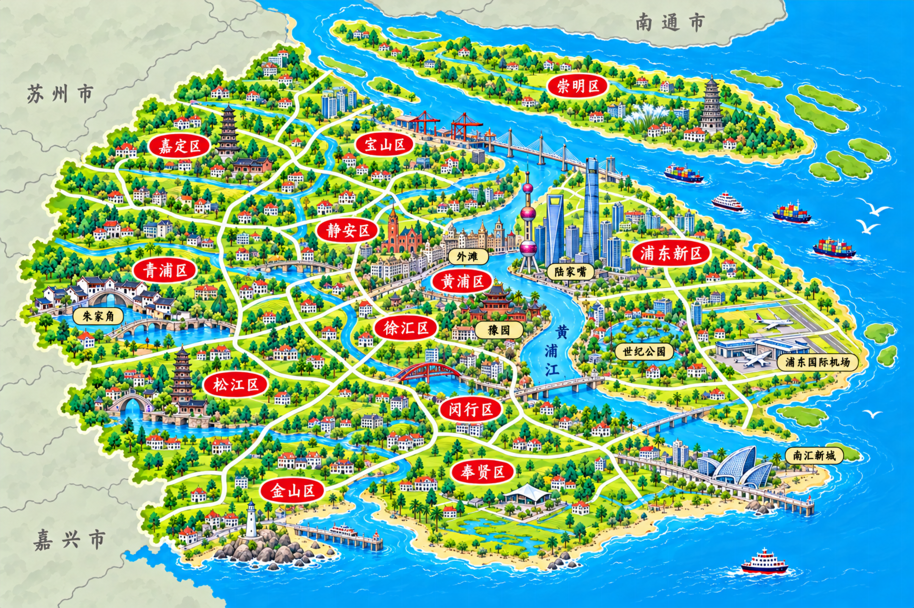

> 2026-10-31 美食图片最新状态：仅保留并启用长沙 12 张图片，直接存放于 img/美食图片/；其余城市美食图片及旧图集已删除，以下旧批次美食图片说明仅作历史记录。当前进度见 docs/美食图片生成进度.md。

# 首批美术审核 · 北京、上海、西安、杭州

状态：4张最新版城市美食地图已按用户要求启用；16张美食审核稿仍待审核。

地图已按泉州卡通风格重绘，去掉大标题和美食插图。旧版地图保存在 `img/城市美食地图/历史版本/`，不作为当前待审核稿。地图为景点与区域示意，重点审核风格、景点标签及方位关系。

全部数据路径见 [城市记录表](CITY_CATALOG.md) 与 [JSON数据源](../assets/data/cities.json)。可反馈“上海城市美食地图的某处”或“北京炸酱面”，即可逐张修改。

## 北京

| 美食图片 | 审核稿 |
| --- | --- |
| 北京烤鸭 | （旧美食图片已删除） |
| 北京炸酱面 | （旧美食图片已删除） |
| 北京涮羊肉 | （旧美食图片已删除） |
| 北京驴打滚 | （旧美食图片已删除） |

## 上海

| 美食图片 | 审核稿 |
| --- | --- |
| 上海小笼包 | （旧美食图片已删除） |
| 上海生煎包 | （旧美食图片已删除） |
| 上海葱油拌面 | （旧美食图片已删除） |
| 上海排骨年糕 | （旧美食图片已删除） |

## 西安

| 美食图片 | 审核稿 |
| --- | --- |
| 西安肉夹馍 | （旧美食图片已删除） |
| 西安羊肉泡馍 | （旧美食图片已删除） |
| 西安凉皮 | （旧美食图片已删除） |
| 西安油泼面 | （旧美食图片已删除） |

## 杭州

| 美食图片 | 审核稿 |
| --- | --- |
| 杭州东坡肉 | （旧美食图片已删除） |
| 杭州西湖醋鱼 | （旧美食图片已删除） |
| 杭州龙井虾仁 | （旧美食图片已删除） |
| 杭州片儿川 | （旧美食图片已删除） |

