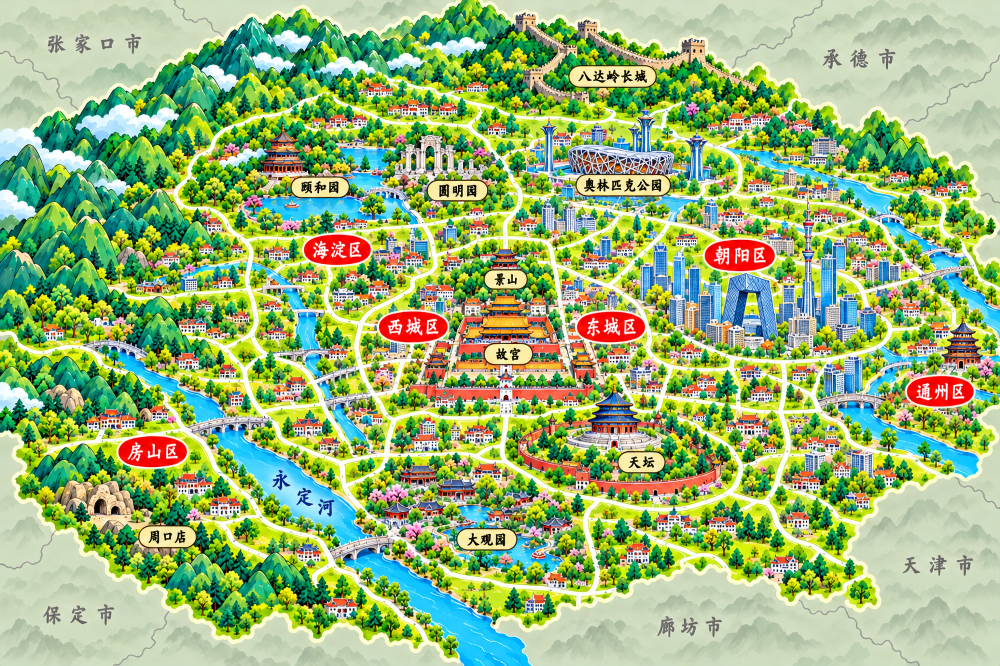

# 北京城市地图新版

日期：2026-10-31。状态：待审核。沿用已确认的长沙第二版风格，以北京原地图为地标构图参考。

交付路径：`img/城市美食地图/北京城市美食地图.png`。

## 视觉与构图

3:2 横幅，明亮青绿卡通山水、微缩地标、奶油白道路、红色城区牌、淡金景点标签。无指南针、大标题、标题框、美食插画。外围为浅灰绿底、淡山影、细灰交界线、灰色手写周边地名。

保留北部及西部山地、西北长城与园林、北侧奥林匹克公园、中心故宫与景山、东南天坛、西南大观园与周口店、东部现代城区和通州的关系。大观园采用古典园林而非宝塔，周口店采用洞穴遗址形象。景点与距离艺术化压缩，仅为旅行景点示意。

外围地名：西北张家口市、北及东北承德市、西南保定市、南部廊坊市、东及东南天津市。

地理参考：[首都之窗·走进北京](https://www.beijing.gov.cn/renwen/)、[北京市科委·京津冀空间格局](https://kw.beijing.gov.cn/xwdt/kcyx/xwdtkfhz/202403/t20240305_3818811.html)、[廊坊市政府·城市综述](https://www.lf.gov.cn/Category_79/Index.aspx)。外围仅作邻接方位提示，不作为精确行政边界。

## 版本记录

内置 image_gen，以北京原地图和已确认长沙图作为参考生成新版。旧待审核图保留在同类型历史版本目录；正式地图保持原资源，待用户确认新版后再启用。

## 高清替换完成（2026-10-31）

已按用户要求使用小鹿 Image 2×、PNG高清处理，结果3072×2048，写入正式地图目录并更新游戏引用。对应待审核低清图及历史旧图已删除；本记录取代上文待审核、首稿留档及不启用说明。
