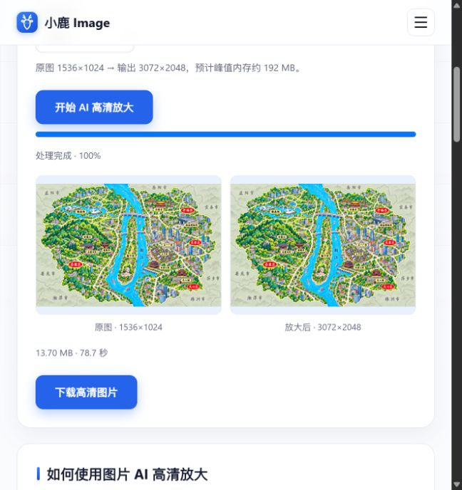

# 城市地图高清处理记录

2026-10-31，使用本软件内浏览器的[小鹿 Image](https://deerimage.com/tools/upscale-image)，ESRGAN、2×、PNG。

北京、杭州、上海、西安、长沙均由1536×1024处理为3072×2048，已下载、验证PNG完整性及复制一致性，并替换正式地图、更新引用。对应待审核原图与历史旧稿按用户要求删除。

删除文件：

- `img\城市美食地图\待审核\上海城市美食地图.png`
- `img\城市美食地图\待审核\上海城市美食地图.png.import`
- `img\城市美食地图\待审核\北京城市美食地图.png`
- `img\城市美食地图\待审核\北京城市美食地图.png.import`
- `img\城市美食地图\待审核\杭州城市美食地图.png`
- `img\城市美食地图\待审核\杭州城市美食地图.png.import`
- `img\城市美食地图\待审核\西安城市美食地图.png`
- `img\城市美食地图\待审核\西安城市美食地图.png.import`
- `img\城市美食地图\待审核\长沙城市美食地图.png`
- `img\城市美食地图\待审核\长沙城市美食地图.png.import`
- `img\城市美食地图\历史版本\上海城市美食地图-v1-有标题与美食.png`
- `img\城市美食地图\历史版本\上海城市美食地图-v1-有标题与美食.png.import`
- `img\城市美食地图\历史版本\上海城市美食地图_v2_新版前.png`
- `img\城市美食地图\历史版本\上海城市美食地图_v2_新版前.png.import`
- `img\城市美食地图\历史版本\北京城市美食地图-v1-有标题与美食.png`
- `img\城市美食地图\历史版本\北京城市美食地图-v1-有标题与美食.png.import`
- `img\城市美食地图\历史版本\北京城市美食地图_v2_新版前.png`
- `img\城市美食地图\历史版本\北京城市美食地图_v2_新版前.png.import`
- `img\城市美食地图\历史版本\杭州城市美食地图-v1-有标题与美食.png`
- `img\城市美食地图\历史版本\杭州城市美食地图-v1-有标题与美食.png.import`
- `img\城市美食地图\历史版本\杭州城市美食地图_v2_新版前.png`
- `img\城市美食地图\历史版本\杭州城市美食地图_v2_新版前.png.import`
- `img\城市美食地图\历史版本\西安城市美食地图-v1-有标题与美食.png`
- `img\城市美食地图\历史版本\西安城市美食地图-v1-有标题与美食.png.import`
- `img\城市美食地图\历史版本\西安城市美食地图_v2_新版前.png`
- `img\城市美食地图\历史版本\西安城市美食地图_v2_新版前.png.import`
- `img\城市美食地图\历史版本\长沙城市美食地图_v1.png`
- `img\城市美食地图\历史版本\长沙城市美食地图_v1.png.import`

验证：5张正式高清地图均通过Godot Texture2D实际加载与尺寸检查。项目原有宜昌、成都、重庆、广州地图资源缺失，仍会产生既有加载报错。
