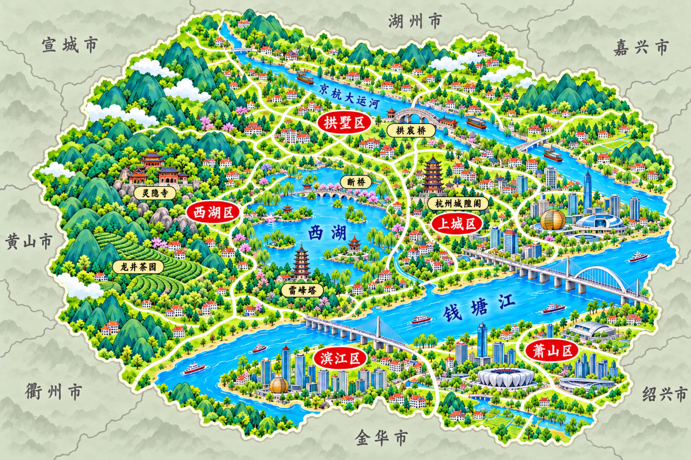
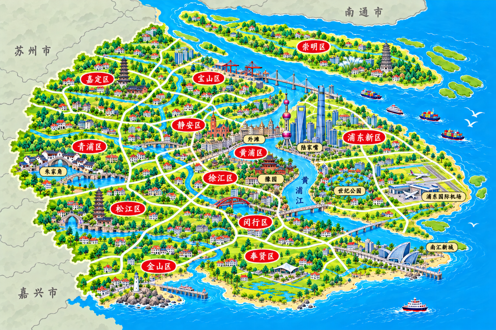
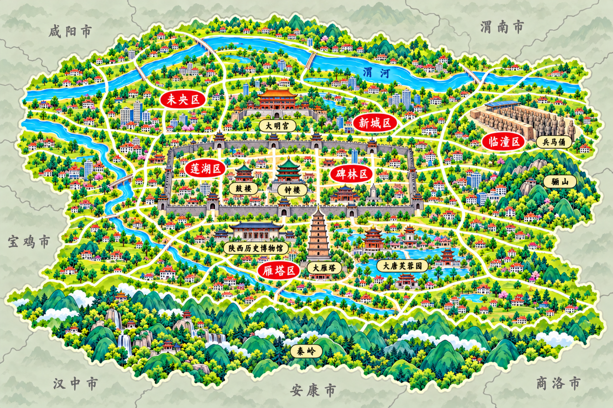

# 杭州、上海、西安地图新版

日期：2026-10-31。状态：待审核。

三城以各自原地图为构图参考，以已确认的长沙第二版为风格参考，由内置 image_gen 分别制作。统一 3:2 横幅、青绿卡通微缩地标、奶油白道路、红色城区牌、金色景点标签；去除指南针及北字，无大标题和食物插画。外围采用浅灰绿底、灰色细线和灰色手写相邻城市名称。

## 杭州

保留西湖、灵隐寺、龙井茶园、雷峰塔、断桥、城隍阁、京杭大运河、拱宸桥与钱塘江关系。外围标注湖州、嘉兴、绍兴、金华、衢州、黄山、宣城。

## 上海

保留长江口、崇明、黄浦江、外滩、陆家嘴、豫园、朱家角、浦东机场与东海、杭州湾。地貌以平原水乡为主；外围省名改为苏州、嘉兴、南通城市名称，南通位于长江口北侧陆地。

## 西安

保留古城墙、钟鼓楼、大明宫、大雁塔、陕西历史博物馆、大唐芙蓉园、兵马俑、骊山与秦岭，渭河位于城市北侧。外围标注咸阳、渭南、宝鸡、汉中、安康、商洛。蓝田县属于西安市，不再作为外围相邻城市标注。

## 地理与版本说明

参考：[杭州政府地理介绍](https://eng.hangzhou.gov.cn/art/2024/7/22/art_811223_58876367.html)、[上海统计局地理位置](https://tjj.sh.gov.cn/zrdl/20180819/0014-216815.html)、[西安政府自然地理](https://www.xa.gov.cn/sq/csgk/zrdl/1.html)。

地标大小和距离均艺术化压缩，外围表示邻接方向，不表达精确行政边界。新版放入各城待审核路径，旧待审核稿保存至同类型历史版本目录；正式地图待确认后启用。

## 高清替换完成（2026-10-31）

已按用户要求使用小鹿 Image 2×、PNG高清处理，结果3072×2048，写入正式地图目录并更新游戏引用。对应待审核低清图及历史旧图已删除；本记录取代上文待审核、首稿留档及不启用说明。
