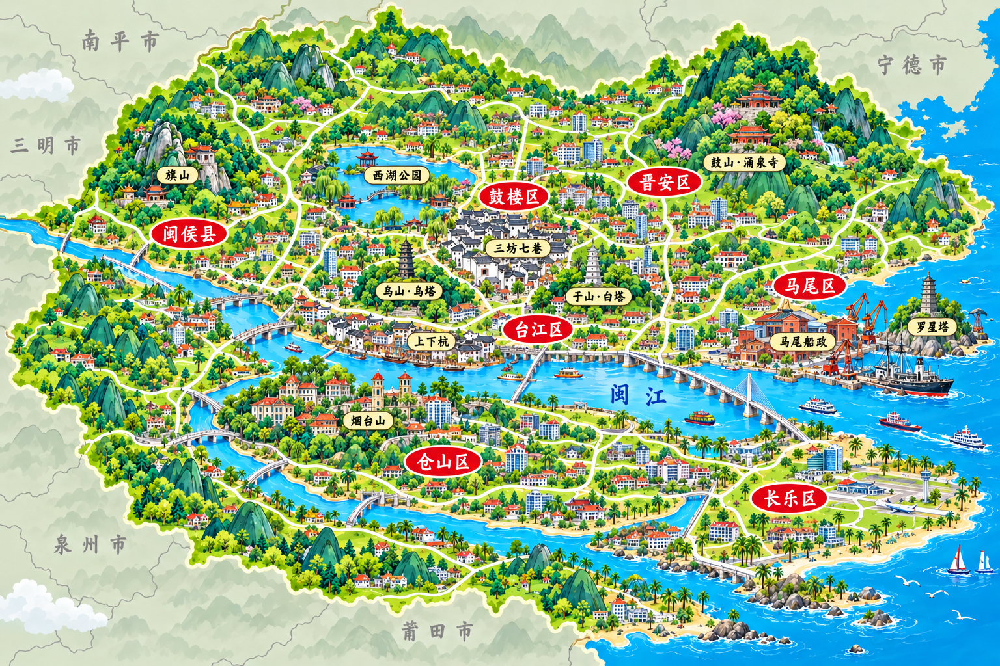

# 福州城市地图

日期：2026-10-31。状态：已按用户要求正式启用。

交付路径：`img/城市美食地图/福州城市美食地图.png`。

延续泉州及已确认长沙、北京的地图系列：3:2横幅、青绿卡通山水、微缩城市地标、奶油白道路、红色城区牌、淡金景点标签。无指南针、大标题、标题框和食物插画。外围为浅灰绿背景、淡山影、细灰交界线及灰色手写邻市名称。

## 山水与地标

闽江自西向东流经城区，南台岛位于江南，两支水道及跨江桥梁构成主体骨架。北岸老城表现西湖公园、三坊七巷、乌山乌塔、于山白塔、上下杭；南岸表现烟台山近代建筑群；东侧表现鼓山涌泉寺、马尾船政、罗星塔，长乐位于河口东南侧。西侧旗山、城区榕树强化福州特色。

外围城市按方位标注：北侧宁德、西北南平、西侧三明、西南泉州、南侧莆田。地标、距离与范围艺术化压缩，外围仅表示相邻方向，不作为精确行政边界或导航地图。

参考：[福州市政府自然地理](https://www.fuzhou.gov.cn/zgfzzt/zjrc/zrdl/202210/t20221026_4457469.htm)、[福州市统计年鉴基本市情](https://www.fuzhou.gov.cn/zwgk/tjxx/tjnj/202503/P020250331601924524204.pdf)。

## 生成与接入

内置 image_gen，以泉州正式地图作风格参考。已按用户要求直接接入正式地图，更新 flat_map_image 及状态；首页按现有地图可用性规则自动纳入福州。

