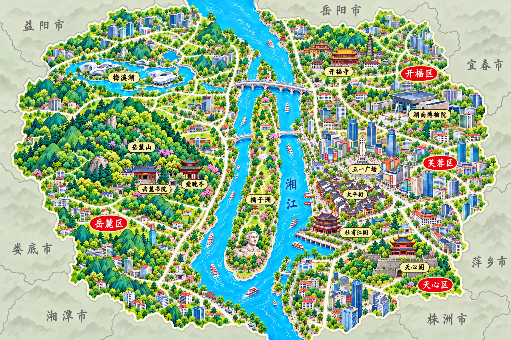

# 长沙城市地图首稿

日期：2026-10-31。状态：待审核。

交付位置：`img/城市美食地图/长沙城市美食地图.png`。

## 视觉规范

参考 `img/城市美食地图/泉州城市美食地图.png` 与项目 AGENTS.md：3:2 横幅、明亮黄绿色平原、圆润青绿山体、蓝色水系、奶油白道路、微缩建筑、红底白字城区牌和淡金色景点标签。无大标题、标题框、食物插画、菜名和页脚。留出道路与草地用于后续交互标记。

## 构图

采用长沙中心城区的山水洲城景点示意，上北下南。湘江纵贯画面，西岸岳麓山、东麓书院与爱晚亭，江心为南北狭长橘子洲，青年毛泽东雕像位于洲南端。东岸安排开福寺、湖南博物院、五一广场、太平街、杜甫江阁、天心阁；梅溪湖位于西侧。地标适度放大、距离艺术化压缩，不表达行政边界或导航精度。

地理依据：[湖南省文化和旅游厅·橘子洲](https://whhlyt.hunan.gov.cn/whhlyt/news/sxxw/202609/t20260923_34070837.html)、[湖南省政府·长沙城市设计](https://www.hunan.gov.cn/hnszf/hnyw/szdt/202302/t20230212_29244520.html)。

## 生成与审核

使用内置 image_gen，以泉州正式地图作为风格参考生成独立长沙地图。重点检查中文标签、山江洲城相对位置、地标辨识度与风格一致性。仅登记待审核资源，确认后再写入正式地图字段。

## 第二版调整

去除右上角指南针与北字；外围采用泉州地图式浅灰绿底、细灰交界线和灰色手写地名，加入益阳市、娄底市、岳阳市、宜春市、萍乡市、株洲市、湘潭市。外围仅为邻接方位示意，非精确行政边界。旧首稿保存于同类型历史版本目录，当前待审核图片路径不变。周边地区依据：https://www.weather.com.cn/cityintro/101250101.shtml 。

## 高清替换完成（2026-10-31）

已按用户要求使用小鹿 Image 2×、PNG高清处理，结果3072×2048，写入正式地图目录并更新游戏引用。对应待审核低清图及历史旧图已删除；本记录取代上文待审核、首稿留档及不启用说明。
